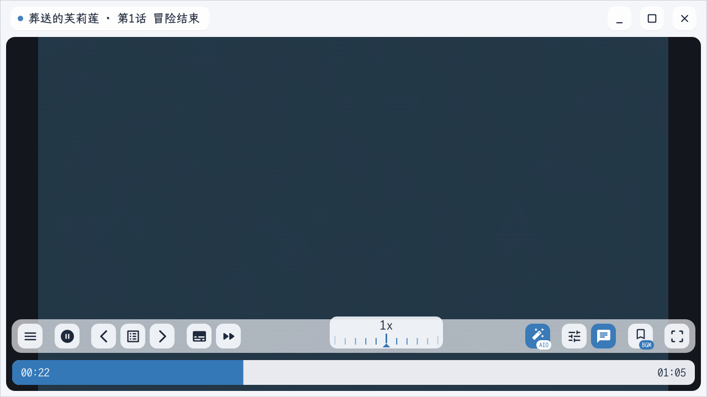

# Soft Porcelain MPV

一款面向本地追番场景定制的亮色系 Windows MPV 播放器配置，基于 [`mpv-lazy`](https://github.com/hooke007/mpv_PlayKit) 修改。

整体采用浅灰白的「柔雾瓷白」极简风格，开箱即用，集成自动弹幕、可视化弹幕调节、画质预设、跳过 OP/ED 与 Bangumi 追番进度同步。

> 手机端配套应用：[瓷白 MPV（Android）](https://github.com/CWINDOWX/mpv-soft-porcelain-android)

> [!NOTE]
> 本仓库仅包含配置与脚本，不含 MPV 程序本体，也不提供任何影视资源。请先下载 `mpv-lazy`，再替换其中的 `portable_config` 目录。

---

## 预览



| 画质预设 | 弹幕样式面板 |
| :---: | :---: |
|  |  |

---

## 主要功能

- **浅色极简界面**
  - 柔雾瓷白配色，搭配圆角边框、常驻标题栏与底部控制栏。
  - 标题栏自动显示当前番剧名、集数与单集标题，点击可切回原文件名。
  - 右键菜单和底栏弹窗随光标就近展开，可在「工具」中独立切换界面字体（支持搜索本机已安装字体）。
- **自动弹幕与样式面板**
  - 打开本地番剧自动匹配并加载弹幕，也支持手动搜索、添加外部弹幕源和调整延迟。
  - 按 `Ctrl+Shift+D` 打开可视化弹幕样式面板，实时拖动调节字号、透明度、显示区域、速度、描边、阴影和密度，支持风格预设、独立切换本机字体、屏蔽与简繁转换。
- **画质预设**
  - 内置原画、轻锐化、Anime4K、ArtCNN、FSRCNNX 等 8 档预设，可叠加去色带与 60fps 补帧。
  - 切换后自动记住，下次打开自动恢复。
- **跳过 OP / ED**
  - 自动识别视频章节中的片头、片尾与预告。
  - 支持弹窗询问、自动跳过或关闭，自动跳过后可按 `Alt+Backspace` 一键退回。
- **Bangumi 进度同步**
  - 自动识别当前番剧与集数，支持一键标记本集已看，也可开启片尾提醒或自动同步。
  - 登录凭据仅保存在本地。

---

## 安装与使用

1. 下载并解压 Windows 版 [`mpv-lazy`](https://github.com/hooke007/mpv_PlayKit)。
2. 备份原有的 `portable_config` 目录，将本仓库克隆为 `mpv-lazy\portable_config`：
   ```bash
   git clone https://github.com/CWINDOWX/mpv-soft-porcelain.git portable_config
   ```
3. 将视频拖入 `mpv.exe` 即可使用。

**使用提示：**

- **Bangumi 登录**：按 `Ctrl+B`（或点底栏书签图标）打开菜单 → 生成并复制 Access Token → 点击「从剪贴板登录」。
- **弹幕接口**：默认使用社区公共弹幕中继，如遇访问波动或失效，可在 `script-opts/uosc_danmaku.conf` 中修改 `api_server` 更换为自己的中继地址。
- **自定义字体**：默认使用系统字体，右键「工具 → 界面字体 / 弹幕字体」或弹幕样式面板可随时搜索并切换本机已安装的任意字体（如霞鹜文楷、思源黑体等）。

---

## 常用快捷键

| 功能 | 快捷键 |
| :--- | :--- |
| 右键主菜单 | 鼠标右键 / 中键 |
| 播放列表 | `Tab` |
| 弹幕开关 | `Z` |
| 弹幕样式面板 | `Ctrl+Shift+D` |
| 搜索弹幕 / 弹幕管理 | `Ctrl+D` / `Shift+D` |
| 画质预设菜单 | `Shift+A` |
| 切换上 / 下一个画质预设 | `A` / `D` |
| 跳过当前 OP / ED | `S` |
| OP / ED 跳过设置 | `Shift+S` |
| 撤销自动跳过 | `Alt+Backspace` |
| Bangumi 同步菜单 | `Ctrl+B` |
| 截图（含字幕 / 完整窗口） | `Ctrl+S` / `Ctrl+Shift+S` |
| 调节倍速 | `[` / `]` 或 `{` / `}` |
| 快捷键一览 | `Ctrl+I` |

---

## 致谢与协议

本仓库中的原创脚本与主题修改采用 **MIT License**，引用的第三方组件均保留原版权与协议（详情见 [LICENSE.md](LICENSE.md)）：

| 组件 | 来源 | 协议 |
| :--- | :--- | :--- |
| mpv-lazy / mpv_PlayKit | [hooke007/mpv_PlayKit](https://github.com/hooke007/mpv_PlayKit) | CC BY-NC-SA 4.0 / 混合协议 |
| uosc | [tomasklaen/uosc](https://github.com/tomasklaen/uosc) | LGPL-2.1 |
| uosc_danmaku | [Tony15246/uosc_danmaku](https://github.com/Tony15246/uosc_danmaku) | MIT |
| thumbfast | [po5/thumbfast](https://github.com/po5/thumbfast) | MPL-2.0 |
| Anime4K / ArtCNN / FSRCNNX 等着色器 | 见各 `.glsl` 文件头 | MIT / LGPL / CC BY-NC 4.0 |
| Material Icons 图标字体 | Google Material Icons | Apache-2.0 |

> [!IMPORTANT]
> 因包含非商业（`CC BY-NC`）及 `LGPL` 组件，本整合配置仅供个人非商业使用。
