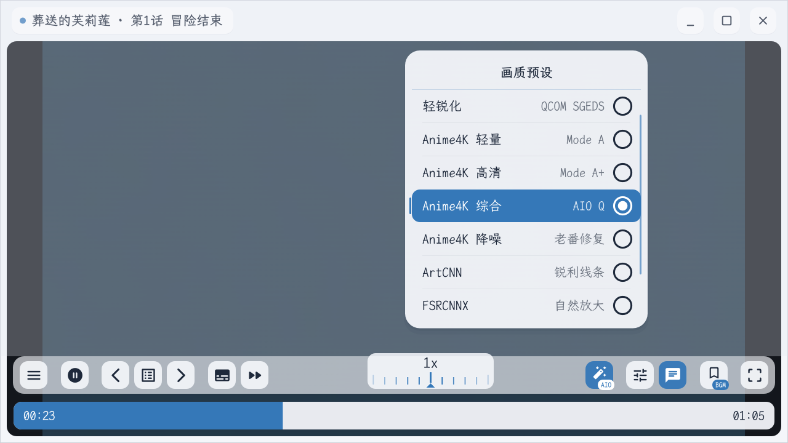
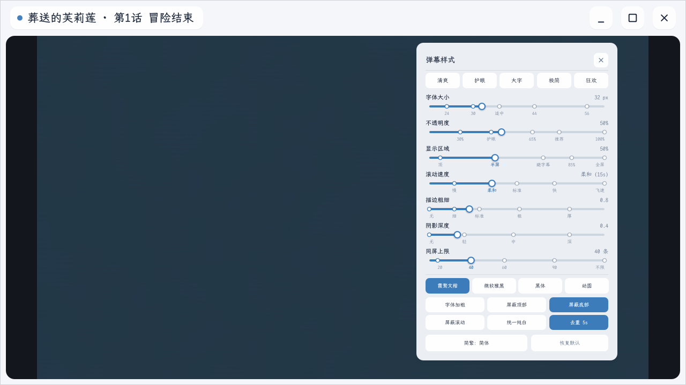

# Soft Porcelain MPV · 柔雾瓷白番剧播放器配置

基于 [`mpv-lazy`](https://github.com/hooke007/mpv_PlayKit) 深度定制的 **MPV `portable_config`** 配置包。  
在保留 MPV 原生高画质与高刷流畅度的基础上，提供**柔雾瓷白（Soft Porcelain Mist）亮色极简界面**、**自动弹幕与磁吸样式滑块面板**、**Anime4K / ArtCNN / FSRCNNX 画质预设持久化**、**章节 OP/ED 跳过**以及 **Bangumi 追番同步与单集标题识别**。

> [!NOTE]
> 本仓库仅包含 `portable_config` 配置与脚本，不含 `mpv.exe`、`python.exe`、`VapourSynth` 等播放器本体文件。请先获取 `mpv-lazy` 懒人包后再覆盖/替换其 `portable_config` 目录。

---

## 界面预览


| 画质预设菜单 | 弹幕样式滑块面板 |
| :---: | :---: |
|  |  |

---

## 核心特性

### 1. 柔雾瓷白（Soft Porcelain Mist）亮色极简 UI
- 基于 `uosc` 深度定制：8px 瓷白外框 + 12px 内圆角视口 + 44px 常驻圆角顶栏（非全屏通过 `video-margin-ratio` 预留空间不遮挡画面，全屏自动隐藏）。
- 顶部栏自动显示 **「番剧名 · 第X话 单集标题」**（联动 `uosc_danmaku` 与 Bangumi 剧集信息，离线自动回退文件名解析），单击即可与原文件名互切。
- 底部浮动控制栏与浮动圆角进度条逐像素对齐，全界面按钮与浮层采用无描边纯矢量渲染，边缘顺滑无白边。
- 右键菜单与底栏二级弹窗均随光标就近弹出（空间不足自动翻向），底栏弹窗期间控制栏与进度条保持常驻可见。
- 面向高刷屏优化 `display-resample` + `interpolation`，无帧率倍率误杀。

### 2. 自动弹幕与交互式样式面板
- 集成 `uosc_danmaku`，支持本地哈希匹配、文件名解析、同目录自动续集记忆与多源添加，90Hz 墙钟插值 + 预缓存 ASS 弹幕体，高刷屏滚动丝滑。
- **自研交互式弹幕样式滑块面板（`Ctrl+Shift+D`）**：7 组带磁性贴合点的实时拖动滑块（字号、不透明度、显示区域、滚动速度、描边、阴影、同屏上限）、5 套一键预设、4 款字体、6 个屏蔽/去重胶囊、简繁切换与自动持久化保存。

### 3. 画质着色器预设与持久化（`shader_presets.lua`）
- 内置 8 档预设（原画 / QCOM 轻锐化 / Anime4K 轻量 / Anime4K 高清 / Anime4K 综合 / Anime4K 降噪 / ArtCNN / FSRCNNX），支持叠加 **去色带（hdeband）** 与 **60fps 补帧（MVTools）**。
- 所有选择自动保存至本地 `saved-shader-preset.json`，下次打开自动恢复。

### 4. 智能章节 OP / ED 跳过（`chapter_skip.lua`）
- 自动识别视频内嵌章节中的 OP / ED / 下集预告，支持 **右下角柔白胶囊提示询问**、**自动跳过**、**关闭** 三种模式并持久化保存。
- 自动跳过后 6 秒内可按 `Alt+Backspace` 一键退回起点。

### 5. Bangumi 番剧识别与进度同步（`bangumi_sync`）
- 依托 `mpv-lazy` 内置 `python.exe` 运行，无需额外安装 Python 依赖。
- 自动识别番剧并缓存单集标题用于顶栏展示；遇到英文/罗马音文件名弹幕未命中时自动向 `uosc_danmaku` 回传中文番名补全弹幕。
- 支持剪贴板一键粘贴 Access Token 登录（仅保存在本地 `bangumi-auth.json`），片尾剩余 ≤ 90 秒支持弹窗确认 / 自动同步 / 仅手动三种模式。
- 菜单内点击「标记本集已看」直接在当前二级菜单内显示 **正在请求 → 同步成功 / 请求失败**，不闪烁关闭菜单。

---

## 安装与使用

1. 下载并解压 Windows 版 [`mpv-lazy`](https://github.com/hooke007/mpv_PlayKit)（建议保留其内置 `python.exe` 以使用 Bangumi 同步功能）。
2. 备份原有的 `portable_config` 文件夹，将本仓库克隆或解压为 `mpv-lazy\portable_config`：
   ```bash
   git clone https://github.com/CWINDOWX/mpv-soft-porcelain.git portable_config
   ```
3. 直接拖入本地番剧到 `mpv.exe` 即可使用。

### 常用配置说明

- **Bangumi 同步登录**：
  按 `Ctrl+B`（或点击底栏书签按钮）→ 点击「获取 Access Token」在浏览器生成个人 Token 并复制 → 回到菜单点击「从剪贴板登录」。凭据仅存放在本地 `portable_config/bangumi-auth.json`（已被 `.gitignore` 排除）。
- **弹幕服务器地址**：
  位于 `script-opts/uosc_danmaku.conf` 的 `api_server` 项。仓库默认填写了社区公开中继地址，**如遇限流、失效或希望分担公益站点流量，请自行替换为可用的中继或自建弹幕 API 地址**。

---

## 快捷键速查

| 功能 | 快捷键 |
| :--- | :--- |
| 打开精简主菜单 | 鼠标右键 / 中键 |
| 播放列表（同目录全集） | `Tab` |
| 开关弹幕 | `Z` |
| 弹幕样式滑块面板 | `Ctrl+Shift+D` |
| 搜索 / 重配弹幕 | `Ctrl+D` |
| 弹幕管理菜单 | `Shift+D` |
| 添加自定义弹幕源 | `Alt+D` |
| 打开画质预设菜单 | `Shift+A` |
| 切换上 / 下一个画质预设 | `A` / `D` |
| 立即跳过当前 OP / ED | `S` |
| OP / ED 跳过设置菜单 | `Shift+S` |
| 撤销刚执行的自动跳过 | `Alt+Backspace` |
| Bangumi 同步菜单 | `Ctrl+B` |
| 截图（含字幕 / 完整窗口含弹幕） | `Ctrl+S` / `Ctrl+Shift+S` |
| 上 / 下微调倍速 | `[` / `]` 或 `{` / `}` |
| 快捷键一览 | `Ctrl+I` |

---

## 致谢与开源协议（Credits & Licenses）

本项目基于众多优秀的开源项目构建。本仓库中**原创脚本与配置修改**以 **MIT License** 开源；引用的所有第三方脚本、着色器与字体均保留原版权声明并各自遵循其原始许可协议（完整说明见 [LICENSE.md](LICENSE.md)）：

| 项目 / 组件 | 作者 / 仓库 | 许可协议 |
| :--- | :--- | :--- |
| **mpv-lazy / mpv_PlayKit**（基础配置、`input_plus`、`save_global_props`、`vs/`） | [hooke007/mpv_PlayKit](https://github.com/hooke007/mpv_PlayKit) | CC BY-NC-SA 4.0 / 混合上游协议 |
| **uosc**（界面框架及 `ziggy-windows.exe`） | [tomasklaen/uosc](https://github.com/tomasklaen/uosc) | LGPL-2.1 |
| **uosc_danmaku**（弹幕加载与渲染基础） | [Tony15246/uosc_danmaku](https://github.com/Tony15246/uosc_danmaku) | MIT |
| **thumbfast**（进度条缩略图预览） | [po5/thumbfast](https://github.com/po5/thumbfast) | MPL-2.0 |
| **contextmenu_plus**（源自 `mpv-menu-plugin`） | [tsl0922/mpv-menu-plugin](https://github.com/tsl0922/mpv-menu-plugin) | GPL-2.0-only |
| **Anime4K** | [bloc97/Anime4K](https://github.com/bloc97/Anime4K) | MIT |
| **Ani4Kv2 ArtCNN** | [Artoriuz/ArtCNN](https://github.com/Artoriuz/ArtCNN) / Sirosky | MIT（架构）/ CC BY-NC 4.0（权重） |
| **FSRCNNX / CuNNy / nnedi3 / CfL / hdeband / AMD FSR / QCOM SGEDS / Adaptive Sharpen** | 各原着色器作者（见各 `.glsl` 文件头） | MIT / BSD / LGPL-2.1 / LGPL-3.0 |
| **LXGW WenKai Mono Lite（霞鹜文楷）** | [lxgw/LxgwWenKai](https://github.com/lxgw/LxgwWenKai) | SIL OFL 1.1 |
| **Material Icons Round** | Google Material Icons | Apache-2.0 |

> [!IMPORTANT]
> 由于仓库包含 `CC BY-NC`（`mpv_PlayKit`、`Ani4Kv2 ArtCNN`）及 `GPL-2.0-only` / `LGPL` 组件，**请勿将本仓库整体用于商业用途或移除原文件头版权声明**。
